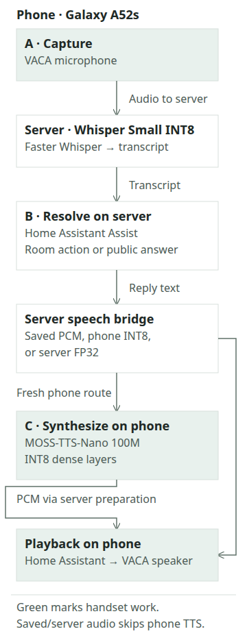
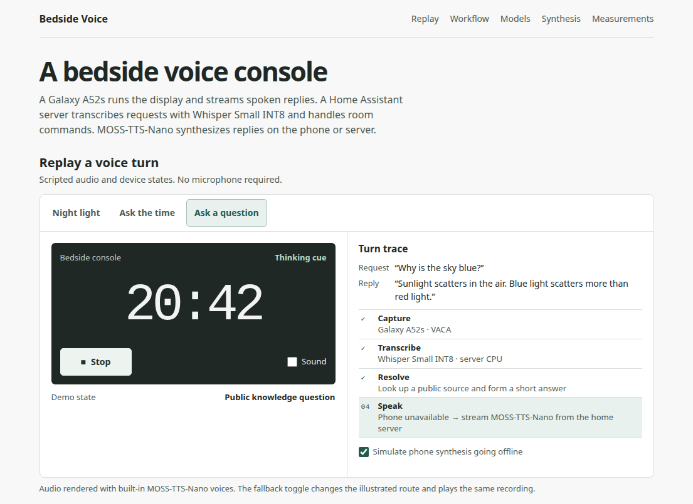
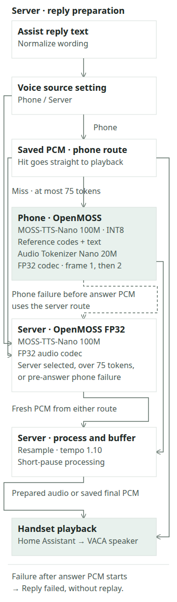

# Bedside Voice

A Home Assistant voice console built on a spare Galaxy A52s. **Whisper Small INT8** transcribes speech on the home server. **MOSS-TTS-Nano 100M** streams replies from the phone CPU, with a full-precision server fallback.

## From a spoken request to a reply

VACA captures microphone audio after a tap on the Galaxy A52s. The server runs Faster Whisper with the Whisper Small INT8 model, then passes the transcript to Home Assistant Assist to resolve a room command or an answer. Public knowledge questions can add a Wikipedia lookup and local Qwen3 4B Instruct generation.

The server's speech bridge routes the reply to saved audio, MOSS-TTS-Nano INT8 on the handset, or MOSS-TTS-Nano FP32 on the server. The handset handles capture, synthesis on the phone route, and playback. The server handles recognition, intent resolution, audio preparation, and delivery through Home Assistant.

## Models and where they run

| Job | Model | Use in this project |
| --- | --- | --- |
| Speech recognition | [Whisper Small INT8](https://huggingface.co/rhasspy/faster-whisper-small-int8) | English speech on the server CPU via [Faster Whisper](https://github.com/SYSTRAN/faster-whisper) and [Wyoming](https://www.home-assistant.io/integrations/wyoming/). |
| Speech synthesis | [MOSS-TTS-Nano 100M ONNX](https://huggingface.co/OpenMOSS-Team/MOSS-TTS-Nano-100M-ONNX) | Primary bedside voice. The Android build quantizes dense layers to INT8. The server runs the FP32 graph for fallback. |
| Audio codec | [MOSS Audio Tokenizer Nano 20M ONNX](https://huggingface.co/OpenMOSS-Team/MOSS-Audio-Tokenizer-Nano-ONNX) | Decodes generated audio tokens into PCM. The Android decoder stays FP32 and streams incremental chunks. |
| Optional public Q&A | [Qwen3 4B Instruct](https://ollama.com/library/qwen3:4b-instruct) | Local Ollama can compose a short answer from retrieved Wikipedia passages. Direct extraction handles simpler questions. Home Assistant Assist resolves room commands. |
| Wake-word trial | [Custom openWakeWord classifier](https://github.com/dscripka/openWakeWord) | TFLite on Android. Hands-free wake is paused after false triggers. Tap-to-talk is the active entry point. |
| Separate phone Assist pipeline | [Piper `en_US-lessac-medium`](https://huggingface.co/rhasspy/piper-voices/tree/main/en/en_US/lessac/medium) | Server-side speech synthesis for standard phone Assist. The bedside console uses the MOSS pipeline. |

## Try the replay

[Download the ZIP](https://github.com/darren236/home-assistant-voice-demo/archive/refs/heads/main.zip), extract it, and open `site/index.html` in Chrome. The replay uses scripted device states and audio rendered with built-in MOSS-TTS-Nano voice presets.

- [Night Light](site/audio/night.mp3) uses a saved spoken confirmation and sets the simulated room state to 10% warm white.
- [Ask the time](site/audio/clock.mp3) illustrates the pre-generated clock bank.
- [Ask a question](site/audio/sky.mp3) plays a thinking cue before a fresh answer. The phone-offline toggle illustrates server fallback with the same recording.

## Inside the streaming synthesis path

The deployed system has a voice-source setting with Phone and Server choices. With Phone selected, the server normalizes the reply and checks its saved PCM bank. A cache hit goes straight to playback. A fresh reply of up to 75 SentencePiece tokens goes to the warm Android model. MOSS-TTS-Nano 100M uses INT8 dense layers to generate audio tokens from text and reference audio codes. The FP32 MOSS Audio Tokenizer Nano 20M decoder reconstructs PCM, decoding the first frame alone and then two frames at a time.

Server selection, a reply above the phone token limit, or a phone failure before answer PCM uses the server's FP32 model. The server resamples fresh PCM, applies pitch-preserving tempo and short-pause processing, and buffers it for Home Assistant playback. A thinking cue may already have played before fallback. A failure after answer PCM starts ends the reply without replaying it.

The saved bank holds **1,440 clock clips** and **82 common and volume confirmations**. These replies bypass live synthesis on the phone route. A fresh answer can play a short thinking cue while generation runs.

## Project engineering

OpenMOSS supplies the speech model and codec, Faster Whisper supplies recognition, and Home Assistant supplies intent resolution. The project builds the integration around these components.

- An Android speech service with INT8 dense-layer conversion, a warm model, and incremental codec scheduling.
- A Wyoming speech bridge with a saved PCM bank, text normalization, phone/server routing, and fallback before answer audio.
- Streaming resampling, pitch-preserving tempo, guarded pause processing, and playback buffering.
- Playback acknowledgements and a guard that limits wake detections during speech.

This repository packages the replay, diagrams, sample audio, and a sanitized synthesis measurement summary. The operational project holds the Android service, speech proxy, conversion tools, and detailed deployment records.

## What was measured

| Test | Result | Timing boundary |
| --- | --- | --- |
| Warm INT8 synthesis on the Galaxy A52s, 24 replies | First PCM **279–360 ms**, median **288 ms**. Native real-time factor **0.838–1.004×**, median **0.942×**. | From input-token arrival. First PCM can contain silence. The RTF denominator is native generated audio duration, before tempo and pause processing. |
| Voice pipeline, 120 turns with outgoing audio | **1.22 s** median and **7.30 s** at the 90th percentile. | End of capture to first outgoing audio, which can be the thinking cue. Mixed normal use and test replays. |
| Wake-word detector, 20-clip offline replay | The original deployed classifier detected 10/10 intended calls and falsely triggered on 5/10 negatives. The replacement trial detected 8/10 intended calls and falsely triggered on 0/10 negatives. | Small offline comparison. An unattended room false-wake rate has yet to be measured. |

The [November 3 synthesis summary](site/data/synthesis-2026-11-03.json) records three threads, CPU spinning, and two-frame codec batches after the first frame. Its first signal-bearing PCM chunk arrived in **279–416 ms**, median **288 ms**. That boundary uses a normalized sample-amplitude threshold of 0.005. Speaker onset was outside this test.

Native RTF is generation time divided by native audio duration, before the server's 1.10× tempo, pause processing, and protective tail. At the faster 1.10 playback pace, the recorded chunk arrivals needed at most **169 ms** of extra startup buffer. The earlier FP32 run took 1.70–1.89× native audio duration across three replies. Precision, thread count, and codec scheduling differed between runs.

Two handset microphone replays illustrate the timing boundaries. Capture end to first outgoing audio took **1,295 ms** for a fresh reply with a cue and **1,064 ms** for a pre-generated clock reply. Bridge request to first answer PCM took **1,147 ms** and **7 ms**, respectively. Both received playback acknowledgements. Each route has one observation, and the two clocks start at different points.

## Source and assets

`site/` is the complete static demo. Its HTML, CSS, JavaScript, and MP3s run from the extracted folder or any static host. `site/turns.js` contains the captions and playback timestamps. `site/diagrams/` contains the editable SVG figures, with desktop and stacked mobile layouts. The README uses PNG exports in `media/`. The project measurements above come from recorded deployment and component tests, separate from the browser replay.

Built by **darren236**. [Home Assistant Assist](https://www.home-assistant.io/voice_control/voice_remote_local_assistant/) · [VACA](https://github.com/msp1974/ViewAssist_Companion_App) · [OpenMOSS](https://github.com/OpenMOSS/MOSS-TTS-Nano)
